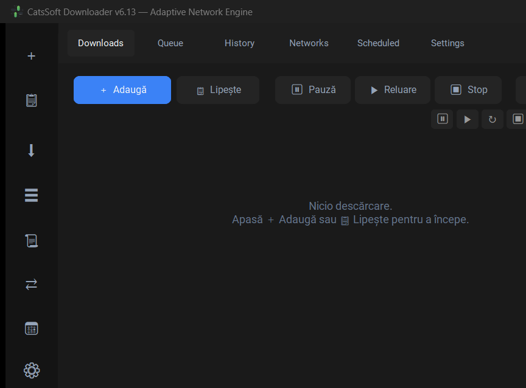

# CatsSoft Downloader


Descărcător pentru Windows cu motor de transfer adaptiv: **segmentare**, **reluare**
cu validator, **multi-adaptor**, **proxy** și interfață CustomTkinter în română.



---

## Funcționalități

**Motor de transfer**

- Segmentare adaptivă în fragmente de 1–8 MiB, cu grila recalculată după viteza
  măsurată (`AdaptiveStreamController`)
- Reluare cu validator (`ETag` / `Last-Modified`) prin `If-Range`
- Îmbinarea segmentelor **verificată prin dimensiune**, nu presupusă
- Retry cu backoff la erori tranzitorii, pe fiecare segment
- Cădere automată pe calea simplă când nu e spațiu pentru copia de asamblare
- Curățarea segmentelor `.part` / `.race` orfane

**Rețea**

- Multi-adaptor: mai multe trasee în paralelă, cu traseele moarte scoase din
  rotație după cooldown
- Conexiuni keep-alive reutilizate (sesiune HTTP partajată)
- Proxy **HTTP / HTTPS / SOCKS5**, aplicat pe sesiunea globală și pe fiecare
  adaptor; proxy invalid → valoare veche păstrată + avertisment; SOCKS5 fără
  PySocks → ignorat, fără eroare

**Interfață**

- Carduri cu gest **swipe**, ETA, viteză, dimensiune și progres
- Sortare dinamică în tab-ul Descărcări: **viteză / dimensiune / ETA**
- Teme întunecată, tooltips pe toate butoanele, trunchierea numelor lungi
- Bara de sistem (tray) + notificări, monitor de clipboard opțional

**Date**

- SQLite per-utilizator, cu coadă activă persistentă și **dirty flag** (se
  scrie doar când chiar s-a schimbat)
- Istoric cu export **CSV** cu neutralizarea formulelor (CSV injection)
- Programări `once` / zilnice cu reluare și recurență
- Salvare **atomică** a setărilor

## Descărcare

Preia bin-ul din pagina de [Release](https://github.com/CatsSoft-Ro/CatsSoft-Downloader/releases):

| Fișier | Pentru cine |
|---|---|
| `CatsSoft Downloader v6.13.exe` (~37 MB) | **Utilizatori** — un singur fișier, fără Python instalat |
| `CatsSoft-Downloader-v6.13-portable.zip` | exe + documentație, dezarhivat și rulat |
| `CatsSoft-Downloader-v6.13-source.zip` | **Dezvoltatori** — sursa completă |

Baza de date se creează automat în `%LOCALAPPDATA%\CatsSoft\Downloader\`. Dacă
există o bază de date veche lângă aplicație, e folosită în continuare.

## Rulare din sursă

```bash
git clone https://github.com/CatsSoft-Ro/CatsSoft-Downloader.git
cd CatsSoft-Downloader
pip install customtkinter requests pillow pystray plyer
python CatsSoft_Downloader_v6.13_Plexo_Engine.py
```

Sau, din pachet: `python main.py`.

> Rulează cu **Python 3.10+** (de preferință Portable Python 3.10 — unele
> diferențe de versiune de tkinter se văd la distrugerea widget-urilor).

## Structura proiectului

Sursa de adevăr e **pachetul** `catssoft/`. Fișierul `.py` de 9.896 de linii e un
**artefact de build**, generat automat din pachet.

```
CatsSoft-Downloader/
├── catssoft/                  # sursa de adevăr
│   ├── core/
│   │   ├── engine.py           # segmentare, reluare, îmbinare (1.714 linii)
│   │   ├── network.py          # multi-adaptor, proxy (487)
│   │   ├── database.py         # SQLite, istoric, export (589)
│   │   ├── automation.py       # clipboard, tray (222)
│   │   ├── config.py           # setări (76)
│   │   ├── scheduler.py        # programări (115)
│   │   ├── smart.py            # automatizări (181)
│   │   ├── security.py         # Windows Defender (102)
│   │   ├── models.py           # DLStatus, Download (205)
│   │   ├── patches.py          # patch-uri tkinter/CTk la import (281)
│   │   └── capabilities.py     # tray / notificări opționale (15)
│   ├── ui/
│   │   ├── main_window.py      # DownloadManager (3.291)
│   │   ├── cards.py            # swipe + DownloadCard (578)
│   │   ├── details.py          # panoul de detalii (454)
│   │   ├── dialogs.py          # AddURL + reluare coadă (514)
│   │   ├── theme.py            # sistemul de teme (373)
│   │   └── widgets.py          # widgeturi tematizate (343)
│   └── utils/
│       ├── files.py            # nume de fișier, baza de date (586)
│       └── formatting.py       # formatare, ETA, dimensiuni (57)
├── tools/
│   ├── build_exe.py            # construiește executabilul (PyInstaller)
│   └── verify_build.py         # verifică consistența pachet ↔ artefact
├── tests/                      # 153 de teste + controale negative
├── main.py                     # punct de intrare al pachetului
├── build_single_file.py        # pachet → fișier unic
└── CatsSoft_Downloader_v6.13_Plexo_Engine.py   # artefactul generat
```

Fiecare bloc de cod poartă ancora cu linia sa din fișierul original
(`# ── orig:6634 ──`), iar fișierul unic e o concatenare în ordinea ancorelor.
De aceea diferența textuală față de versiunea anterioară e **exact 2 zone**, ambele
intenționate (calea pictogramei).

## Construiește din sursă

```bash
python build_single_file.py     # pachet → fișier unic
python tools/build_exe.py       # pachet → executabil Windows (~37 MB)
python tools/verify_build.py    # build la zi + echivalență AST
```

`tools/build_exe.py --onedir` produce un director în loc de un singur `.exe`
(start mai rapid, fără extragere temporară).

## Teste

```bash
run_tests.bat
```

Rulează suita pe **ambele forme** (pachet și fișier unic) și apoi **controalele
negative** — reconstruiesc comportamentul pre-fix și cer ca testele de regresie
să pică. Detalii în [`tests/README.md`](tests/README.md).

| | |
|---|---|
| 153 de teste automate | verzi pe ambele forme |
| 8 grupuri de controale negative | 34 fragmente de reverție, pe ambele forme |
| Semnătură AST | 134 de definiții identice, aceeași ordine |

## Documentație

- [`REPORT_v6.13.md`](REPORT_v6.13.md) — raport tehnic complet: audit, bug-uri
  reparate, feature-uri, măsurători
- [`CHANGELOG.md`](CHANGELOG.md) — istoricul versiunilor
- [`MODULE_SPLIT_PLAN.md`](MODULE_SPLIT_PLAN.md) — cum e organizat pachetul și de
  ce e sigură împărțirea

## Licență

MIT — vezi [`LICENSE`](LICENSE).
